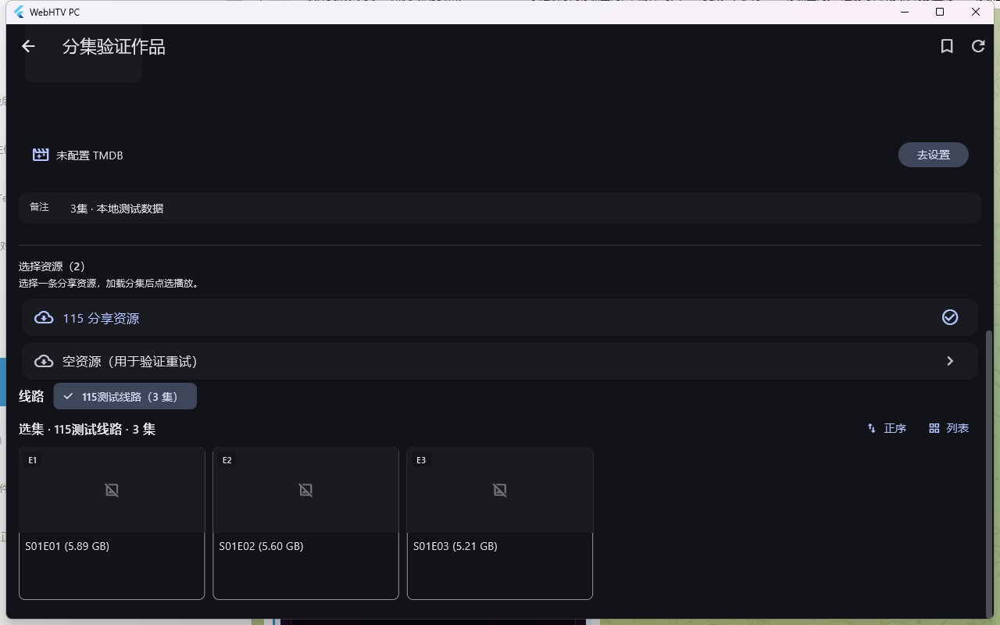

# T4 网盘分集与播放代理验证

日期：2026-10-10。

## 行为（历史迭代记录）

本文件记录 2026-10-10 的第一版实现：点击目录中的分享资源后，PC 再调用 `ids=<分享资源>`，展示该资源的线路和分集。该中间层已被 2026-10-11 的统一线路实现替代；当前契约请看 [桥接线路标准化验证](t4-standard-bridge-lines.md)。

共同保留的契约是：点选某集时才调用 `play=<该集原始目标>&flag=<原始线路名>`；`atvp_resume:` 是详情句柄，不作为分集目标；作品身份、海报与历史记录沿用原目录条目。

`AndroidPlaybackBridge` 处理 Android T4 网关返回的回环媒体地址：

- 局域网连接使用设备主机，保留媒体服务的独立端口、路径和签名 query。
- 本机 ADB 网关连接通过 `adb forward --list` 反查同一台设备，复用该设备已有媒体转发；需要新建时使用 `tcp:0` 动态分配端口。
- 找不到对应设备或转发失败时报告桥接错误，不猜测设备序列号或固定媒体端口。
- `AppState.dispose()` 触发回收；只撤销本实例创建且仍属于同一设备的映射。已有映射保留。
- 公网媒体地址和普通 HTTP API 站点沿用原路径；播放 Header、字幕和弹幕元数据保留。

## 自动验证

在 `apps/desktop-flutter` 中使用 Puro 的 `webhtv` 环境：

```powershell
$t4Tests = @(
  'test/phase5_folder_episodes_test.dart',
  'test/phase5_android_playback_bridge_test.dart',
  'test/phase5_bridge_detail_test.dart',
  'test/phase3_detail_page_test.dart',
  'test/phase3_detail_race_test.dart',
  'test/phase2_playback_target_test.dart',
  'test/config_and_site_test.dart',
  'test/phase5_android_bridge_test.dart',
  'test/phase5_android_bridge_service_test.dart'
)
puro -e webhtv -p . flutter test --reporter expanded @t4Tests
```

结果：126 项通过。新增界面测试先复现了旧代码在点击分享资源后立即发出 `play=` 的问题，修复后还验证第二集目标、空结果重试和迟到响应隔离。

改动涉及的 6 个 Dart 文件执行定向 `dart analyze`：`No issues found!`。Windows Debug 构建成功；未构建 Release。

## Windows 原生界面

使用隔离的数据目录和本地 T4 夹具，在 Debug 桌面应用中操作。分享资源点击后仅发出 `ids=`；屏幕出现 3 张分集卡片。点击第二张后捕获：

```text
play=1@7865@0@1
flag=115测试线路
```

截图中的内容是本地测试数据：



## 真实 Android 与媒体

指定模拟器 5559 的 ADB 连接仍不可用。检查 PC 已保存的桥接配置后，发现现有华为手机网关 `192.168.50.2:9978` 可用，`/device` 返回 200，配置包含 170 个站点。以下测试使用该已配置连接，未更改 Android 源码或安装包。

通过 PC 生产代码的 `AppState.loadDetail` → `loadFolderResource` → `resolvePlayback` 完成：

| 项目 | 实测结果 |
| --- | --- |
| 站点 / 资源 | 木偶[盘] / 暗潮之下的 115 分享资源 |
| 分集 | 1 条线路（丫仙女），6 集 |
| 选择 | `S01E02(5.6 GB)` |
| 原始目标 | `1@7865@0@1` |
| PC 可达媒体主机 | `192.168.50.2:5000` |
| 媒体 Range | HTTP 206，`bytes 0-1023/6016730232`，读取 1024 字节 |
| mpv 解码 | HEVC，3840×2160，24 fps，10-bit；48 帧限制运行正常结束，媒体时长 37:02 |

范围与限制：

- 真机验证覆盖局域网路径。ADB 动态转发、设备隔离、复用和回收由注入命令响应的自动测试覆盖，未在 5559 上实测。
- 该 Android 115 代理重复发送 `Content-Length`，Dart `HttpClient` 探测会拒绝解析；改用 curl 检查 Range，并以应用所用的 mpv 引擎验证解码。此处没有修改 Android 的 HTTP 实现。
- 同设备的 UC 分享能返回“白夜破晓”3 条线路、每条 29 集，但其播放接口返回站源业务错误。直接请求也会失败，PC 如实显示该错误。
- mpv 验证采用无窗口、禁用音频输出、48 帧限制；没有把短片段验证当作整集播放验收。
